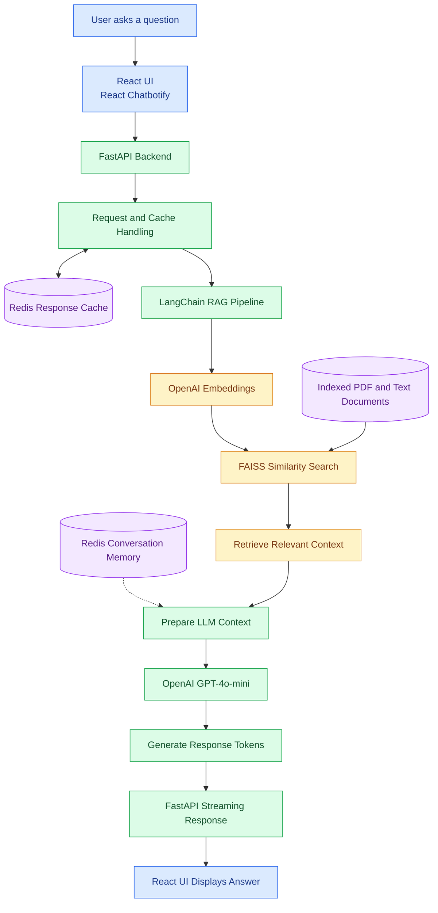

# AI-Powered Chatbot with RAG Pipeline

A document-aware AI chatbot built using **Retrieval-Augmented Generation (RAG)** to answer user questions using relevant information from PDF and text documents. The application combines semantic search, large language models, conversation memory, response caching, and real-time token streaming to deliver context-aware responses.

## Overview

Traditional chatbots may struggle to answer questions grounded in specific documents. This project addresses that challenge by retrieving relevant document content and supplying it as context to a language model before generating an answer.

The application uses **Python, FastAPI, LangChain, OpenAI GPT-4o-mini, OpenAI Embeddings, FAISS, Redis, React, and React Chatbotify** to build an interactive document-question-answering experience.

## Key Features

- **Retrieval-Augmented Generation:** Grounds responses in relevant content retrieved from indexed documents.
- **PDF and Text Document Retrieval:** Supports retrieval from indexed PDF and text resources.
- **Semantic Similarity Search:** Uses OpenAI embeddings and FAISS to identify relevant document content.
- **LLM-Powered Responses:** Integrates OpenAI GPT-4o-mini through LangChain.
- **Real-Time Token Streaming:** Streams responses from the backend to the frontend for better perceived responsiveness.
- **Conversation Memory:** Uses Redis to maintain recent conversation context for follow-up questions.
- **Response Caching:** Uses Redis to cache eligible responses and reduce repeated processing.
- **REST API Backend:** Exposes chatbot functionality through FastAPI endpoints.
- **Interactive User Interface:** Uses React and React Chatbotify for conversational interactions.
- **End-to-End Testing:** Uses pytest to validate chatbot workflows.

## System Architecture

The following diagram illustrates the major components and their interactions.

## End-to-End Workflow

### 1. User Interaction

Users submit questions through the React chatbot interface built with React Chatbotify.

### 2. API Request Handling

The FastAPI backend receives the request and coordinates the chatbot's processing workflow.

### 3. Document Retrieval

The RAG pipeline uses OpenAI embeddings and FAISS similarity search to identify document content relevant to the user's question.

### 4. Context Preparation

The retrieved document content is prepared as context for the language model. Relevant recent conversation history can also be used to support follow-up questions.

### 5. Response Generation

LangChain integrates the retrieved context with OpenAI GPT-4o-mini to generate a context-aware answer.

### 6. Token Streaming

The backend streams generated tokens to the frontend, allowing users to see the answer as it is produced rather than waiting for the complete response.

### 7. Memory and Caching

Redis supports recent conversation memory and response caching for eligible requests, helping reduce repeated processing and improve responsiveness.

## Technology Stack

| Category | Technologies |
|---|---|
| Programming Languages | Python, JavaScript |
| Backend | FastAPI |
| LLM Framework | LangChain |
| Language Model | OpenAI GPT-4o-mini |
| Embeddings | OpenAI Embeddings |
| Vector Search | FAISS |
| Memory and Caching | Redis |
| Frontend | React, React Chatbotify |
| Testing | pytest |

## Performance and Results

Reported project results include:

- **100+ documents:** Document retrieval across a collection of more than 100 documents.
- **500+ queries per day:** Reported workload supported by the chatbot.
- **Approximately 35% lower perceived latency:** Improvement associated with real-time response streaming.
- **End-to-end testing:** pytest used to validate application workflows.

*Performance figures are project-reported results. Publish them as measured outcomes only if you can substantiate them with test results, logs, or other evidence.*

## Use Cases

- Searching internal knowledge documents.
- Asking questions about PDF and text resources.
- Finding relevant information across multiple documents.
- Getting context-aware answers from indexed content.
- Asking follow-up questions within a conversation.

## Future Improvements

- Add a documented document ingestion and indexing workflow.
- Evaluate retrieval quality using a representative question-and-answer dataset.
- Measure answer faithfulness and hallucination rates.
- Add authentication, access controls, and usage monitoring.
- Improve observability with structured logs and latency metrics.
- Provide a reproducible local setup and deployment instructions.

## Repository Contents

As the repository develops, it can include:

- `README.md` — project overview, architecture, workflow, and setup instructions.
- `backend/` — FastAPI application code, if safe to publish.
- `frontend/` — React application code, if safe to publish.
- `tests/` — automated tests, if available.
- `.env.example` — names of required environment variables without actual secrets.

*These are suggested repository sections, not a claim that these files already exist.*

## Security Notes

- Never commit API keys, passwords, database credentials, or private tokens.
- Do not publish confidential company code, internal documents, or sensitive user data.
- Keep secrets in environment variables and provide only placeholder values in examples.
- Publish screenshots and demos only when you have permission to share them.

## Project Summary

This project demonstrates the integration of **RAG, semantic search, LLM-based answer generation, backend API development, conversational memory, caching, and streaming responses** in a document-aware chatbot application.
